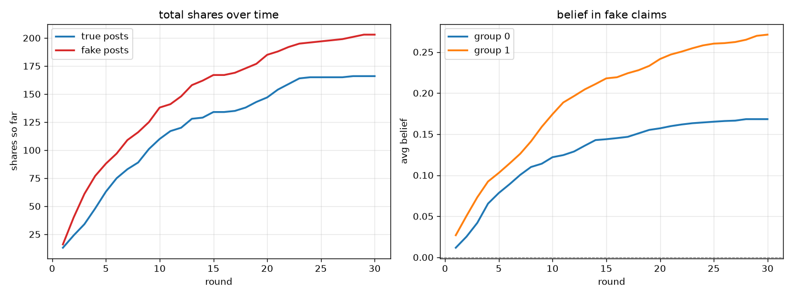
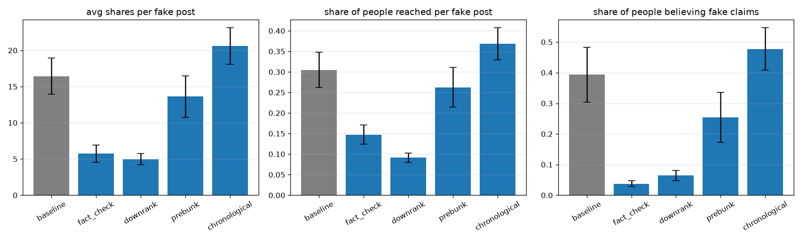

# Misinformation Spread Simulation

This project simulates how fake news spreads through a social network and tests which interventions actually help slow it down.

Most people in the simulation are simple rule-based agents. A smaller group uses a local LLM through Ollama, built as a LangGraph workflow. Everything runs on a laptop, so there are no API keys and no cloud costs.



## Why this project exists

Social platforms try many things to reduce misinformation, such as fact-check labels, downranking posts, and warning users before they see a misleading story. I wanted to compare these methods in a controlled environment where I could run the same setup many times and change only one thing at a time.

## How it works

```
config.yaml
    |
personas -> social network -> posts (10 true, 10 fake)
                  |
       each round:
         1. the intervention is applied
         2. people come online based on their activity
         3. they see a feed of posts shared by friends
         4. they decide whether to share the post
         5. their belief in the fake claims changes
         6. everything is logged
                  |
       metrics -> experiments over 10 seeds -> charts and dashboard
```

**People:** 300 agents are split into two groups with different political leanings. Each agent has a political position, media literacy, sensitivity to emotional content, and a pattern for when they go online.

**Network:** the network uses a stochastic block model, so people are more likely to connect with others in their own group. This creates echo chambers.

**Posts:** the simulation uses fictional local news stories about a made-up city. This keeps the content realistic but avoids spreading real-world misinformation. The fake posts are written to be more emotional, because that is often how misinformation looks in real life. Agents do not know which posts are fake.

**Two decision systems, same interface:**
- `RuleAgent`: decides whether to share based on emotion, agreement with the post, media literacy, and any label shown on the post. This is fast enough for hundreds of agents.
- `LLMAgent`: uses a LangGraph flow that recalls memory, builds a prompt, calls the LLM, and parses the response. If Ollama is down or the output is not valid JSON, it falls back to the rule-based agent so the simulation keeps running. It also gives a reason for each decision.

Both agents follow the same `decide()` method, so the rest of the simulation does not need to know which kind of brain is making the choice.

**Memory + reflection:** each LLM agent remembers its last few decisions (what it saw, whether it shared, and why) and gets reminded if it's seeing a similar claim again. Every few rounds it also reflects: one extra LLM call that sums up what it now believes about the rumours in its city, in its own words, which then gets folded into later prompts. This is all optional (`llm.memory` in `config.yaml`) and never crashes the run - a failed reflection just keeps the agent's previous view.

## Results

This used 5 scenarios and 10 seeds, so 50 runs total. The rule-based agents were used for the main comparison. The ± value is the 95% confidence interval.

| Scenario | Shares per fake post | People believing fake claims | vs baseline |
|---|---|---|---|
| baseline (no intervention) | 16.5 ± 2.5 | 39% ± 9% | |
| fact-check labels | 5.7 ± 1.2 | 4% ± 1% | -65% |
| downranking | 5.0 ± 0.8 | 6% ± 2% | -70% |
| prebunking | 13.6 ± 2.9 | 25% ± 8% | -17% |
| chronological feed | 20.6 ± 2.5 | 48% ± 7% | +25% |



What stands out:
- **Fact-checking and downranking both work well**, and they do it in different ways. Labels change beliefs, while downranking reduces exposure by making the post less visible.
- **Prebunking helps a little**, but the confidence intervals overlap a lot, so it is hard to say for sure with only 10 seeds.
- **Fake posts spread faster than true posts** in the baseline run. They peak earlier, around round 4.9, compared with 5.8 for true posts.
- **Echo chambers can both help and hurt**. When the connection between groups was increased from 0.005 to 0.03, polarization dropped from about 0.10 to 0.03, but belief in fake claims rose to 70% because more people were exposed to fake posts from both groups.

## The LLM agents

The first version of the LLM agents shared too much:

| | Fake share rate | True share rate |
|---|---|---|
| LLM agents, first prompt | 54% | 100% |
| LLM agents, after calibration | 5% | 14% |
| Rule agents | 17% | 18% |

The early LLM reasoning included things like, "Not sure if it's true, but it sounds plausible," and then the model still shared the post. LLMs often lean toward agreeing. I added one sentence to the prompt reminding the model that most people scroll past most posts without sharing them, and the share rate dropped by about ten times. That shows how sensitive these simulations are to wording.

After calibration, the LLM agents were much better at telling true from fake. Their reasons sounded more like real people:

> "This sounds like paranoid nonsense. Bike lanes are not a surveillance tool."

> "This seems believable, but it is a pretty boring topic."

One interesting test case: a low-literacy agent still shared a fake post even with a fact-check label on it, because they said, "I hate bike lanes anyway." The rule agents do not do this, because a label always reduces sharing. This looks a lot like motivated reasoning in real human behavior.

### Memory and reflection

With memory on, agents stop treating every post as if they'd never seen anything before. They recall their last few decisions and occasionally reflect on what they now believe about the rumours in their city, and that view carries into later prompts.

I ran the same simulation twice (6 LLM agents, 15 rounds, same seed), once with memory and once without:

| | Fake share rate | True share rate |
|---|---|---|
| LLM agents, memory off | 5% | 14% |
| LLM agents, memory on | 33% | 56% |
| Rule agents, same runs | 17-19% | 17-18% |

The surprise: memory made the LLM agents share a lot more, both fake and true posts. A possible cause (not proven) is that listing past decisions in the prompt pushes the model to stay consistent with what it did before, so one early share leads to more, which partly undoes the calibration above. It also moved the whole network, even though only 6 of 300 people are LLM agents: 54% of people ended up believing fake claims, against 39% without memory.

The reflections show belief drift. After a few rounds, one agent wrote:

> "I think the police are probably trying to cover up something, and I'm not surprised they'd try to fudge the numbers. It's just like what they did with that airport train, probably some shady dealings behind the scenes."

It connected two separate fake posts into one story, which is how conspiracy thinking tends to build up. Another agent, who started out sceptical, stayed sceptical.

This is a first result from one seed and about 45 LLM decisions per run, not a proven effect. Every decision with its memory context is saved in `results/llm_decisions_memory.csv`.

In this run, 4 of the 46 LLM decisions came with a reminder that the agent had already seen a post on the same topic; these didn't change any share decisions, only belief slightly.

## Run it yourself

```bash
git clone https://github.com/vivekreddy-25/fake-news-spread-simulation.git
cd fake-news-spread-simulation
python -m venv .venv
.venv\Scripts\activate          # Windows
pip install -r requirements.txt
```

For the LLM agents, install [Ollama](https://ollama.com) and pull a model:

```bash
ollama pull llama3.1:8b
```

Then run:

```bash
python -m src.core.simulation               # one run with a summary
python -m src.analysis.metrics              # metrics and charts in results/
python -m src.analysis.experiment           # all scenarios across 10 seeds
python -m src.demos.llm_demo                # 6 LLM agents with memory (about 8 minutes)
python -m src.demos.llm_demo --memory off   # same run without memory (about 5 minutes)
streamlit run app.py                        # dashboard
python -m pytest -v                         # tests
```

All of the settings are in `config.yaml`.

## Project structure

```
src/
  agents/
    __init__.py      exports the rule and llm agents
    rule.py          rule-based decision logic
    llm.py           LangGraph + Ollama agent with memory, reflection and fallback
  models/
    __init__.py      exports model objects and helpers
    personas.py      agent traits and behavior
    network.py       social network with two communities
    content.py       true and fake posts
    feed.py          what each person sees in their feed
  analysis/
    __init__.py      analysis helpers
    metrics.py       reach, cascade depth, belief, polarization
    experiment.py    runs scenarios across many seeds
  core/
    __init__.py      app-level simulation helpers
    simulation.py    main simulation loop
    interventions.py fact-checking, downranking, prebunking
  demos/
    __init__.py      marks the folder as a package
    llm_demo.py      compares LLM agents with rule-based agents, with or without memory
app.py               Streamlit dashboard
tests/               pytest tests (do not require Ollama)
results/             output charts and CSV files
```

## Limitations

- The agents are fictional and not calibrated against real user data.
- There are only 20 posts, so ranking changes do not matter much. That is likely why the chronological feed result is not very meaningful.
- Fact-checking catches every fake post after 5 rounds, which is a best-case scenario.
- The LLM results are based on a small sample, around 40-45 decisions from 6 agents, and they change a lot depending on prompt wording.
- Belief is simplified to a single number per person for each fake claim.

## What I would do next

- Add many more posts so feed ranking matters more
- Compare the results to a basic SIR epidemic model
- Run more LLM agents with a faster model and more seeds for prebunking
- Test whether the memory over-sharing comes from recalling past share decisions, by recalling only beliefs instead
- Calibrate the network and spread behavior against a real dataset such as FakeNewsNet